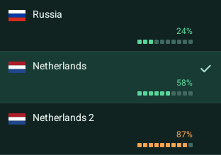

# Try Family Connect

Windows0.2.16 targets Windows10 1809+ /11 x64 and bundles .NET.
After a failed0.2.13 installation, run the new installer over the remaining files.
No manual service setup is needed. Affected Windows10 device acceptance is pending.

[Русский](getting-started.ru.md) · [Home](../README.md)

## First activation

Android8.1+, ARM64; access is invitation-only. Installing the APK does not grant access.
The invitation page and in-app updater both provide beta113. Updating does not enable restricted FIELD access.

Beta113 includes MESH and quiet ongoing VPN-notification updates. Android8.1/API27 is the minimum; Android8.0 and older are unsupported.
Exact Android CI41833086774 attempt2, existing signer and full verified-HTTPS hash checks PASS.
Every mode now lists Russia, Netherlands and Netherlands2, with per-node load squares:
green below85%, orange from85%, grey/dash when unavailable. Selected rows have a green tint
and checkmark. Russia cannot use MESH; choose AWG/TCP/Auto. Owner112→113 installation and
dashboard/load checks PASS; sustained MESH stability and physical Huawei113 acceptance remain open.

Paid baseline remains108 and existing entitlement is preserved. No Mi account or ADB is needed.
MESH still requires accepted admission and current readiness material, not an old cached READY.

1. Ask a participant for their link/QR from **Settings → Invite a friend**. Keep it private.
2. Download the APK and install **Family Connect Test**, allowing installation from your
   browser when Android asks. Update an existing installation in place.
3. Return to the original full invitation link, mark **Application installed** and choose **Open application**.
   Allow Family Connect to open. Activation happens inside the app; no manual code is needed.
   If Telegram's embedded browser does not open the app, use an external browser.
4. Select a country and transport beside the battery panel, enable VPN and accept Android's
   VPN prompt. Check the external IP on the Route screen, then open a normal website.

## Update an existing app

[Download beta113 — 50.3 MB](https://185.251.89.19:8443/downloads/FamilyConnect-Test-0.1.18-beta113.apk).
Version `0.1.18-beta113`, code113, ARM64,50273696 bytes; SHA256:

```text
6078d0610272c5eb1b8008d330f9e646163b90b89df180b4bd56fd8ae4edc094
```

The app also checks for updates. An update restarts the VPN; tap Connect again if needed. Open the APK and select **Update** in Android’s system
prompt. Do not uninstall or clear data: activation, keys and history must be kept.
A CI debug APK may use a different signature. Each other device needs its own activation;
do not copy another device’s profiles or keys.

The [older universal beta13](https://185.251.89.19:8443/downloads/FamilyConnect-Test-0.1.12-beta13.apk)
remains available for other architectures,240.5 MB. It lacks current features and is not
an equivalent alternative to113.

[Exact audio corresponding source and licenses](https://185.251.89.19:8443/downloads/FamilyConnect-Android-0.1.18-beta113-audio-source.tar.gz)
are available with the release. Installation requires Android confirmation; it is not forced.

Update over the existing app via **Settings → Check for updates → Install beta113**.
If the old updater fails, download the APK above in a browser. Do not uninstall, clear
data or reenroll. Android sequence7 is optional; installation and operation on the
affected Huawei still need confirmation. [Public108 rollback evidence](https://185.251.89.19:8443/downloads/FamilyConnect-Test-0.1.18-beta108.apk)
remains immutable; no paid event or canary replay accompanies this update.

## Text and voice

Add a contact and verify the full key/fingerprint through a trusted channel. The arrow
sends text; long-press your own text message to edit. Hold the microphone to record,
release to send. Swipe up to lock recording, then use the arrow to send or cross to
cancel. Swipe left while holding to cancel. Recording is limited to60s/128KiB.
Android8.1–9 uses Codec2 (default3200bit/s); confirm Codec2 support with your contact
first. Normal Opus recording requires Android10+. After granting microphone access,
hold again to start. At the limit,
recording stops and waits for sending. Leaving the app cancels an unsent recording.
Use the current version on both phones for the same interface.

The background service receives messages and posts notifications without an active VPN
when the message server is reachable. Check the service and notification settings in the
messenger menu. Screen-off delivery was tested; immediate delivery during deep Doze is
not established. [Notification and announcement guide (RU)](testing/messenger-notices.ru.md).

## Troubleshooting

- No invitation: ask a participant/operator; the APK alone is insufficient.
- VPN without Internet: check the public IP and try another region/transport.
- Missing messages: check connectivity, both registrations, contact keys, background
  service and notification permission. Open the app again after a system force-stop.
- Missing map location: allow approximate location; VPN does not require it.
- Update failure: record the error and versions; do not erase data to bypass a signature mismatch.

Report model, Android/app version and network type. Exclude invitations, keys, profiles
and messages. [Beta113 validation/publication](releases/2026-11-04-android113-server-picker.md#publication-and-readback).

## Desktop clients

[Linux0.2.11 / Windows0.2.16 previews](clients.en.md) also accept invitation links. Linux needs
operator-assisted dependency and VPN-helper setup. Desktop messenger parity with Android
is not claimed. Direct invitations and referral claims use separate pools; limits are not
current availability counts.

## Server load display

Beta113 shows **Server CPU** on the dashboard and **CPU N%** in the server list when
channel capacity is unknown. CPU is not channel utilization or the monthly traffic quota.
Known-capacity servers retain their combined CPU/channel indicator; stale/missing samples show No data.
[Release status](releases.md).

Auto/AWG/TCP/MESH share Russia, Netherlands and Netherlands2. Switching mode keeps the
chosen node. Both NL nodes have MESH paths, subject to admission/readiness; Russia/MESH
is explicitly unavailable. This release does not claim sustained MESH stability.
Each row uses that node's measurements: green squares below85%, orange from85%, grey
and a dash without fresh data, never an inferred country CPU value. CPU-only and estimated
capacity values remain labelled; the two NL channel capacities are assumed5000Mbps,
not a measured connection speed.
