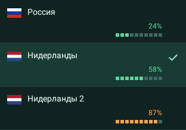

# Попробовать Family Connect

Windows: версия0.2.16, Windows10 1809+ /11 x64. .NET включён в установщик.
После неудачной установки0.2.13 запустите новый установщик поверх оставшихся файлов.
Ручная настройка служб не требуется. Проверка на проблемном Win10 ПК ещё ожидается.

[English](getting-started.en.md) · [Главная](../README.ru.md)

## Первое подключение

Android8.1+, ARM64; доступ только по приглашению. Скачивание APK само по себе не даёт доступа.
Страница приглашения и встроенные обновления предлагают beta113. Обновление не включает restricted FIELD-доступ.

Beta119 — неопубликованный ARM64-кандидат статуса подписки, не новое общедоступное
обновление. По отдельному разрешению установлен поверх118 на Redmi/API31: собственный
ответ «вне пилота» через штатный HTTPS и сохранение кеша после перезапуска проверены.
[Артефакт, серверный контракт и границы проверки](releases/2026-11-06-subscription-android-3.md).

1. Получите ссылку/QR от участника: **Настройки → Пригласить друга**. Ссылку не публикуйте.
2. Скачайте со страницы APK и установите **Family Connect Test**, разрешив установку
   из браузера при запросе Android. Существующее приложение обновляйте поверх.
3. Вернитесь к исходной полной ссылке приглашения, отметьте **Приложение установлено** и нажмите **Открыть приложение**.
   Подтвердите открытие Family Connect. Доступ активируется в приложении, ручной код не нужен.
   Из встроенного браузера Telegram при необходимости откройте страницу во внешнем браузере.
4. На главной выберите страну и транспорт в панели соединения рядом с батареей,
   включите VPN и подтвердите запрос Android. В «Маршруте» проверьте внешний IP,
   затем откройте обычный сайт.

## Обновление существующего приложения

**Для проверки MESH на мобильных белых списках — отдельная тестовая beta118:**
[скачать APK118, 50,3 МБ](https://185.251.89.19:8443/downloads/FamilyConnect-Test-0.1.18-beta118.apk).
Android8.1+/ARM64,50285984 байт, SHA256
`b7b0be92456f522f81d87c71c401c2622d2f823178510b28510a6fb8d5c69fca`.
Установите поверх, не удаляя приложение/данные. Включите диагностику, отключите Wi-Fi,
выберите явно MESH и отдельно проверьте «Нидерланды» и «Нидерланды 2». После сбоя
сохраните диагностику и передайте её лично владельцу вместе с оператором и временем.
[Полная инструкция, исходники аудио и ограничения](releases/2026-11-05-android118-field.md).
Это не подтверждённое исправление стабильности; приглашения и общий updater остаются113.

[Скачать beta113 — 50,3 МБ](https://185.251.89.19:8443/downloads/FamilyConnect-Test-0.1.18-beta113.apk).
Версия `0.1.18-beta113`, code113, ARM64,50273696 байт; SHA256:

```text
6078d0610272c5eb1b8008d330f9e646163b90b89df180b4bd56fd8ae4edc094
```

Проверка обновлений также доступна в приложении. Откройте APK и выберите **Обновить**
в системном окне Android. Не удаляйте приложение и не очищайте данные: сохраняются
активация, ключи и история. Debug APK из CI может иметь другую подпись.
Другому устройству нужна собственная активация; не переносите чужие ключи/профили.

Для других архитектур сохранена [старая универсальная beta13](https://185.251.89.19:8443/downloads/FamilyConnect-Test-0.1.12-beta13.apk),
240,5 МБ. В ней нет актуальных возможностей; это не равноценная замена113.

Beta113 поддерживает MESH и тихое обновление текущего VPN-уведомления. Минимум — Android8.1/API27; Android8.0 и ниже не поддерживается.
Точный Android CI41833086774 attempt2, подпись прежним ключом и полный verified-HTTPS hash PASS.
Во всех режимах один список: «Россия», «Нидерланды», «Нидерланды 2». Нагрузка узла —
зелёные квадратики, с85% оранжевые; без свежих данных — серые и прочерк. Выбранный сервер
отмечен зелёной подложкой и галочкой. Россия не поддерживает MESH: используйте AWG/TCP/Auto.
Установка112→113 и главный экран с нагрузкой проверены у владельца; стабильность MESH
и приёмка113 на самом Huawei остаются открытыми.

Paid baseline остаётся108, существующий доступ сохраняется. Mi-аккаунт и ADB не нужны.
MESH требует действующего допуска и свежей готовности. Установку подтверждает пользователь.
[Исходники аудиокодека и лицензии](https://185.251.89.19:8443/downloads/FamilyConnect-Android-0.1.18-beta113-audio-source.tar.gz).

Обновление перезапускает VPN; при необходимости нажмите «Подключить» снова.

Обновление: **Настройки → Проверить обновления → Установить beta113**, поверх существующей
версии. Если старый updater не справляется, скачайте APK по ссылке выше через браузер.
Не удаляйте приложение, не очищайте данные и не регистрируйтесь заново. Android sequence7
не принудительная; подтверждение установки и работы на проблемном Huawei ещё ожидается.
[Публичная108 сохранена](https://185.251.89.19:8443/downloads/FamilyConnect-Test-0.1.18-beta108.apk)
как неизменяемый артефакт; обновление не создаёт paid event и не повторяет canary.

## Переписка и голосовые

Добавьте контакт в мессенджере, проверьте полный ключ/отпечаток через доверенный канал.
Текст отправляется стрелкой, своё сообщение редактируется долгим нажатием.
Удерживайте микрофон для записи, отпустите для отправки. Свайп вверх фиксирует запись;
после этого стрелка отправляет, крестик отменяет. Свайп влево при удержании отменяет.
Запись до60с/128КиБ; после выдачи разрешения удержите микрофон заново.
На Android8.1–9 используется Codec2 (по умолчанию3200бит/с): сначала подтвердите поддержку
Codec2 у собеседника. Обычная запись Opus требует Android10+.
На лимите запись ждёт отправки. При уходе в фон неотправленная запись отменяется.
Обновите оба телефона до актуальной версии для одинакового интерфейса.

Фоновая служба получает сообщения и показывает уведомления без включённого VPN,
если доступен сервер сообщений. Проверьте её и уведомления в меню мессенджера.
Доставка с выключенным экраном проверена; мгновенная доставка в глубоком Doze не
подтверждена. [Уведомления и объявления](testing/messenger-notices.ru.md).

## Если что-то не работает

- Нет приглашения: обратитесь к участнику/оператору; одного APK недостаточно.
- VPN без интернета: проверьте внешний IP и другой регион/транспорт.
- Нет сообщения: проверьте сеть, регистрацию обоих устройств, ключи контактов,
  фоновую службу и разрешение уведомлений. После принудительной остановки откройте приложение.
- Нет положения на карте: разрешите приблизительную геолокацию; VPN работает и без неё.
- Не устанавливается обновление: запишите ошибку и версии, не удаляйте данные ради обхода подписи.

В отчёте нужны модель, Android, версия приложения и тип сети. Не включайте приглашения,
ключи, профили и переписку. [Приёмка и публикация beta113](releases/2026-11-04-android113-server-picker.md#publication-and-readback).

## Настольные приложения

[Linux0.2.11 / Windows0.2.16 preview](clients.ru.md) также принимают ссылку приглашения.
Linux требует настройки зависимостей и VPN helpers с оператором. Desktop-мессенджер
не имеет подтверждённого равенства возможностей с Android. Прямые приглашения и
referral используют отдельные запасы; параметры50/500 не являются текущим остатком.

## Показ нагрузки сервера

В beta113 главный экран показывает **«CPU сервера»**, а список стран — **CPU N%**, если
скорость канала неизвестна. Это загрузка процессора, не процент канала и не остаток трафика.
Для сервера с известной ёмкостью остаётся общий индикатор; устаревшие/отсутствующие данные
показываются как «Нет данных». [Статус выпуска](releases.md).

В Auto/AWG/TCP/MESH одинаковый список: «Россия», «Нидерланды», «Нидерланды 2»; смена
режима сохраняет выбранный узел. У обоих NL есть MESH с проверкой допуска/готовности;
Россия/MESH явно недоступна. Выпуск не означает подтверждения устойчивости MESH.
В каждой строке — измерения её узла: зелёные квадратики до85%, с85% оранжевые, без свежих
данных — серые и прочерк, не подставленный CPU страны. CPU-only и оценочная ёмкость
помечены отдельно; для обоих NL принято5000Мбит/с, это не измеренная скорость соединения.
