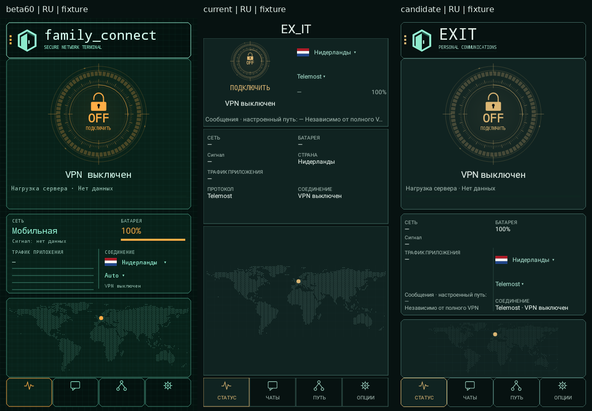
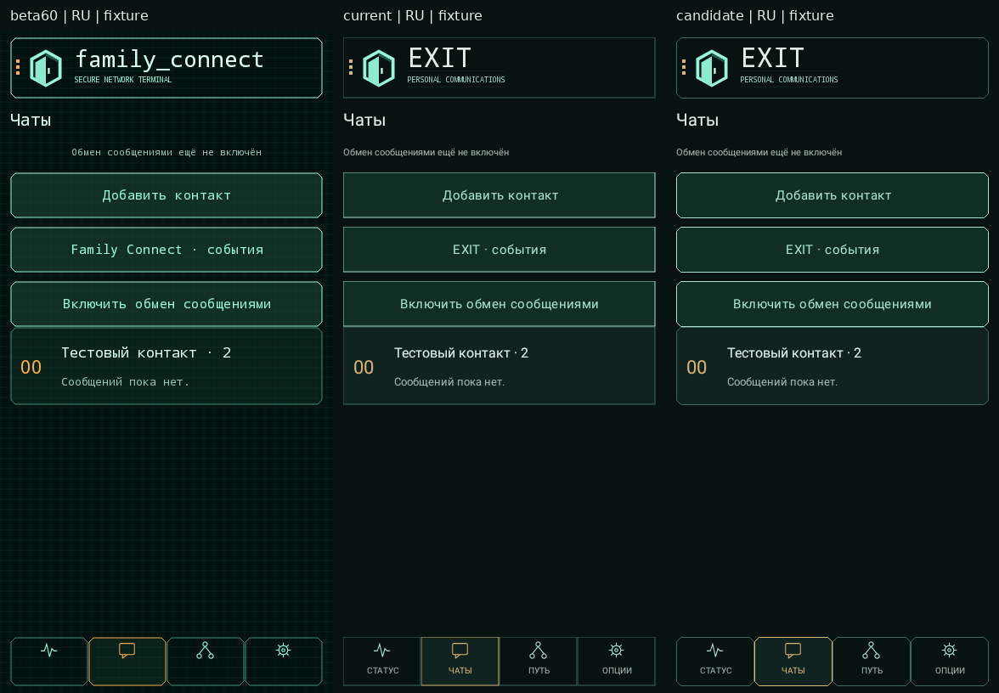
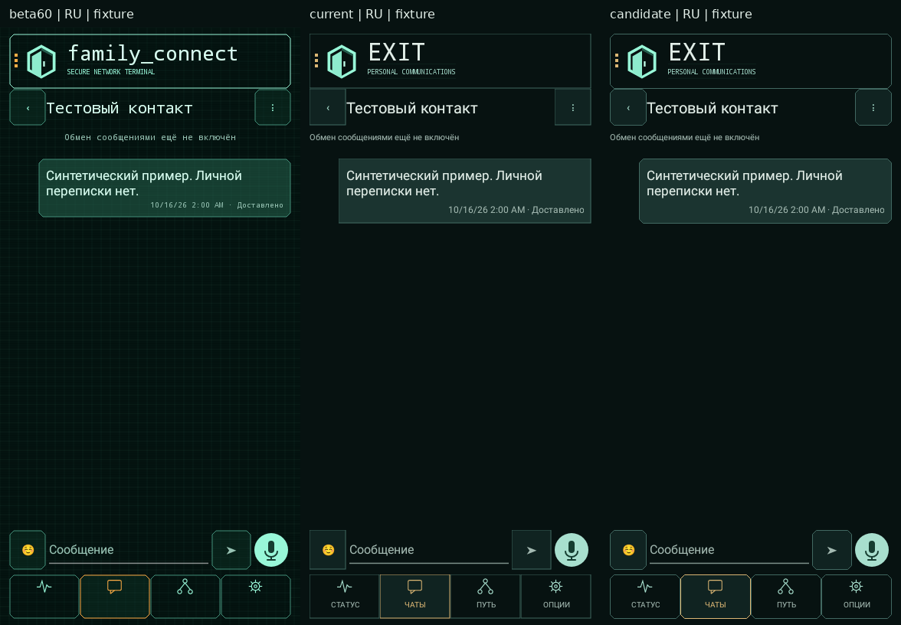
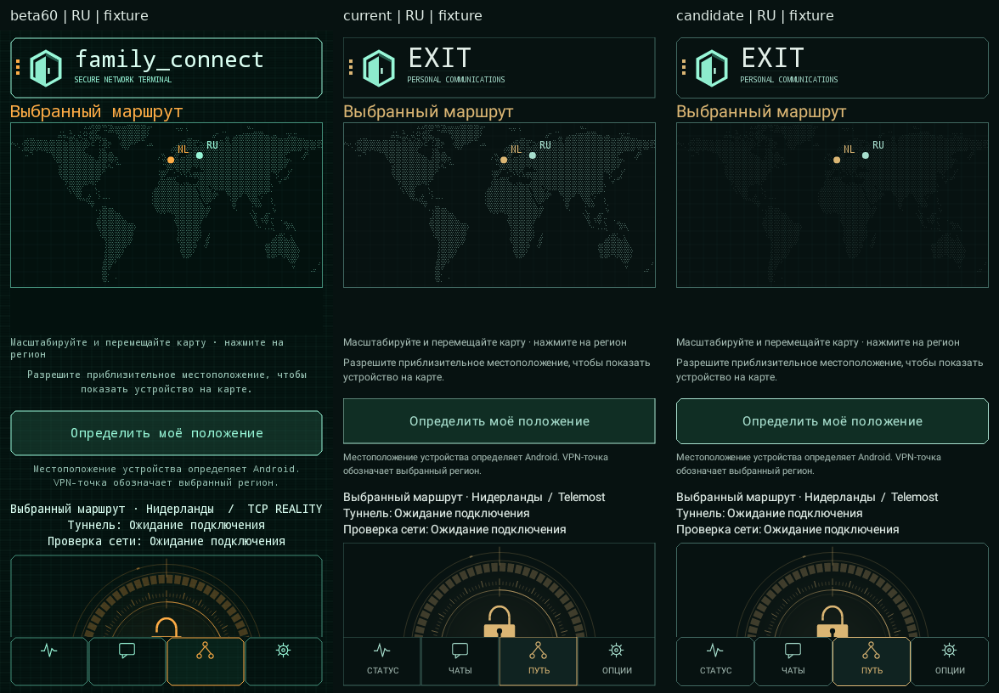
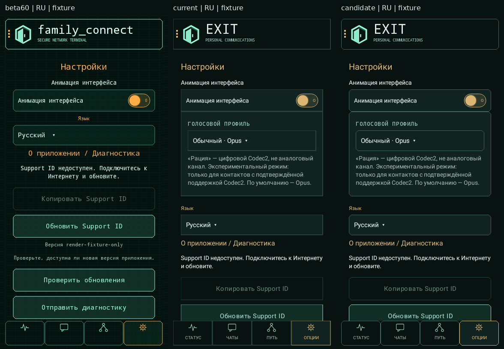

# UI60-LAYOUT-CURRENT-STYLE-1 — implemented UI candidate

Part one of UI60-RESTORE-AND-FIELD-1. **Visual approval pending; no tester delivery.**
This is an isolated derivative of the retained accepted diagnostic product, not a
checkout of beta60 or the dirty root main. Existing snapshots, accepted artifacts and
historical acceptance reports are retained. The field stage has **not started**.

## Exact identities

| Identity | Value |
|---|---|
| Starting review publication | `da2b13eeb66d1335296f4dbd4619ee7692431799` |
| Beta60 visual reference, resolved `5c740f2d` | `5c740f2d05f725ee1bcbe63a41f886605d4c7ac4` |
| Retained beta60 render-input APK | `8ee59352e5f490aea74c3c8c8aeefd0d65bec0c261a044899d512ca376cf6104` |
| Accepted modern cumulative source inventory | `b36c4a21ee6cf04acb192a0e6d140fa565b3e5ae75f6fc8d028d029c3152781d` |
| Retained accepted signed APK, not the UI candidate | `8e5579f04de91e4ec00e3e79271dbb0f380b1ed91945ff89016aa50d274a8845` |
| Modern before-render input, unsigned APK | `b2a4b76b3218ec06f3409154a1a14f71bf4feff3206be3282c25852eabdd35ca` |
| New UI cumulative source inventory, not a Git commit | `dbd0aeb61662c983b628ef00814b2e55cb6c26e3169ddf895b316a5ba3efdd0a` |
| **New unsigned UI APK** | `52e903bb95a21b7b9d91eb01a7188fba6d15a79d2a25bc3dcb6acd7b617fcf6f` |
| Embedded restricted native, reused unchanged | `be70a66ccc2bcbf0478915fd414c32de3bedb2a0ae0c3222a53e65eebd0a92b2` |
| Gateway retained identity, no live query in this task | `a537257162348afc35b1ebc08755d8c5dc1cd90e74c49e3987fb3eb81885e61f` |

Package `com.familyconnect.app.friends`; versionName **0.1.18-research84-ui60-1**;
versionCode **84**, minSdk31, arm64-v8a, unsigned size55,989,392bytes.
No production signing or installation. Code84 deliberately remains compatible with
same-code replacement of the accepted owner APK after matching signer checks. This
does **not** promise ordinary rollback to an unknown tester's lower-code APK. Tester
version/signer/ABI/API and authorization remain prerequisites after visual approval.

Native metadata remains byte-for-byte the accepted native manifest, including its
original source inventory. The separate UI/provisioning build manifest binds the new
UI inventory and identifies native reuse. Neither provenance guard was disabled;
the library is not represented as rebuilt from UI sources.

## What changed

- Main screen returns to beta60 ordering: full header; large centered circular
  switch/status/server load; two-column telemetry and country/transport controls;
  compact map; fixed four-item bottom navigation. No old transport list is copied.
- Chamfered beta60 frame geometry is restored through the shared drawable, including
  buttons, navigation, chat bubbles, route/settings panels and common dialogs.
  Current background, palette, text styling, health colors and animation logic remain.
- Thin shared stroke parameters replace scattered widths in the touched frame,
  toggle, telemetry and map paths. Modern anti-aliasing and density scaling remain.
- Current configured-message-route information fits within the existing telemetry
  section. Modern connection terminals, actual observed transport, diagnostics,
  activation, export, voice preview and settings remain available.
- Chat empty/list/conversation, route and settings already retained beta60's primary
  hierarchy. Their shared geometry is restored rather than replacing these screens
  with historical activity implementations. All newer behavior is retained.
- DISCONNECTING and cleanup-required get distinct localized presentation labels.
  These labels consume existing service state; no TUN-based readiness shortcut or
  new runtime state is introduced.

Accessibility deviations from beta60 are deliberate and bounded: selectors retain
48dp targets, text is not shrunk to beta60's tiny sizes, two-line navigation remains
readable, and a constrained main workspace scrolls independently of navigation.
Country/transport labels wrap naturally (up to three lines); telemetry measures
actual text/selector heights, rather than clipping large-font descriptions.
The main dial keeps the beta60 0.60-width cap in portrait; short landscape uses120dp
so the complete dial remains reachable. The map receives remaining space and
is omitted from the main preview when less than88dp remains; the full Route tab
remains accessible. At normal size the taller accessible controls leave a shorter
map preview than beta60. No decorative panels or additional spaces are introduced.

## Real-code comparisons

All images are **synthetic fixtures**, not CONNECT evidence. Columns are beta60 →
accepted modern UI → new UI, same392×780 logical viewport, density1, RU, fontScale1.
Actual retained APK UI DEX/resources are used, not hand-drawn mockups. The isolated
renderer has no Internet permission, provider/service declarations, native libraries
or production credentials. It invokes real view builders/projection callbacks while
avoiding product onCreate/onResume enrollment and service startup. FLAG_SECURE stays
set; the view tree is rendered to a Canvas, not captured by disabling security.

Additional empty-chat, main-state, narrow/large-font and keyboard evidence is linked
from the [reproduction/evidence index](../../research/ui60-layout-20261016/README.md).
Reference artifacts were frozen before editing; the conversation fixture callback
was corrected during QA and reference images regenerated from the same retained APKs.
This does not substitute current product code into the historical reference.

## Functional and build boundary

- Full offline `assembleResearchProvisioning` with accepted native bytes succeeds.
- 14 targeted JVM cases: UI presentation2, bootstrap correlation2, diagnostic ring5,
  restricted startup3, startup fidelity2. No transport/race/PKI suites rerun.
- Source boundary checks compare the derivative against the retained accepted tree:
  only the listed UI/resources/version-name/test files differ. Connection handlers,
  navigation/lifecycle methods, settings/route actions and telemetry sampling logic
  are unchanged. All other product sources, including async writer/queue64, ownership,
  handoff, generation guards, early correlation, security and storage, are identical.
- All embedded native payloads, not only `libfc_restricted.so`, are byte-identical.
  Permissions, SDK/ABI/features and restricted manifest are unchanged.
- Renderer checks and limits are recorded separately in the evidence index. Fixtures
  are not an ARM64 native runtime test, device acceptance, live export or field trial.
  No claim of API35/OEM keyboard runtime coverage follows from an API31 emulator.
- Final candidate:50 real-code scenes across four configurations, eight navigation
  cycles, retained controls/session state, zero service requests, secure flag retained.
  Button targets remain at least48 logical pixels; selector/message-route labels have
  no measured ellipsis. A separate real-IME ChatThreadView check preserves draft and
  selection; system-bar insets27/54px and IME bottom366px are recorded, not inferred.
  The75 safe screenshots include24 reference frames and51 candidate/component frames.

Eight iterative UI-only assembles were used to resolve measured accessibility/layout
issues; the final unique test count is14, not an aggregate acceptance count. An initial
sandbox Gradle socket denial was resolved by the normal approved external execution.
No transport/race/PKI suite, native rebuild or live acceptance was substituted.

The existing Android dashboard test source now distinguishes fixed navigation from
scrollable workspace controls instead of banning every ScrollView. That legacy
device test suite was not executed; the isolated renderer checks below have their
own explicit scope and do not imply full product lifecycle coverage.

The normal research provisioning mechanism is retained. No gate is enabled, no
credential cache copied, and no identity is embedded for a tester. Its actual device
applicability is still a separate post-approval check, not inferred from owner UID.

## Result / next boundary

| Criterion | Result at this checkpoint |
|---|---|
| UI_LAYOUT_RESTORED | Implemented for main composition and shared frame geometry; chat/route/settings hierarchy retained; accessibility deviations listed above |
| CURRENT_STYLE_AND_THIN_STROKES_PRESERVED | Current palette/background/type and state sources retained; common density-scaled strokes |
| UI_STATE_AND_NAVIGATION_TESTS | 14 targeted JVM cases;50 fixture scenes;8 navigation cycles;real IME component check pass |
| TRANSPORT_NATIVE_SECURITY_UNCHANGED | Exact source boundary and all embedded native payload checks pass; no native rebuild |
| NEW_UI_SIGNED_APK | NOT_CREATED; only the unsigned candidate identified above |
| TESTER_COMPATIBILITY_AND_AUTHORIZATION | NOT_CHECKED; after owner visual approval |
| FIELD_STAGE_AND_RESULT | NOT_STARTED / WAITING_FOR_OWNER_VISUAL_APPROVAL |
| FIRST_FAILURE_OR_REMAINING_BLOCKER | No live failure; owner visual decision is the next gate |
| FINAL_DEVICE_STATE | Phone/tester untouched; no fresh device-state assertion |
| ACTION_COUNTS | UI assemble8; native rebuild0; product signing/install0; CONNECT/export0; server operations0 |

**UI_VISUAL_APPROVAL=WAITING_FOR_OWNER_VISUAL_APPROVAL.**
Product unsigned APK remains local. Production signing, tester selection/contact,
delivery, installation, CONNECT/export, owner ADB and server SSH/actions: **0**.
Only a disposable credential-free emulator is used for fixtures; its debug-only
renderer packages are not product or distribution artifacts.

Previous NEW_PAIR_FAST_RECONNECT=PASS_BOUNDED remains bound to the **previous exact
APK** and gateway. The new UI APK is not automatically device-accepted. Historical
causality, chat handoff, supervisor, field coverage and public release remain open.
Continue with the [field-stage record](2026-10-16-field-1-ui60-warm-start.md) only after
owner visual approval; do not repeat UI development or prior owner reconnect tests.
